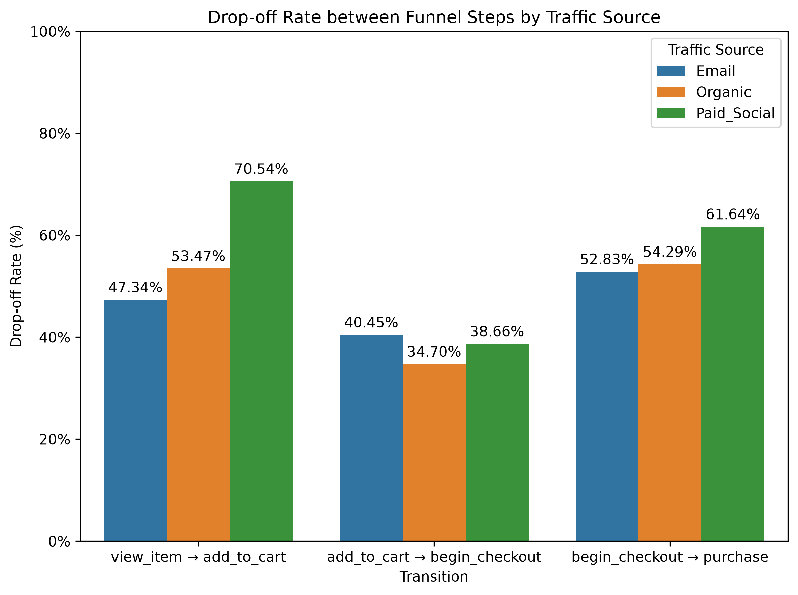

## Objective

The objective is to identify which user segments have the highest drop-off rates at each stage of the funnel and propose improvements based on the findings.

## Data & Methodology

The `events.csv` file contains `event_id`, `user_id`, `event_type`, and `event_timestamp`.

The `users.csv` file contains `user_id`, `signup_date`, `device`, and `traffic_source`.

The funnel consists of four stages in the following order:

1. `view_item` (product viewing)
2. `add_to_cart` (adding a product to the cart)
3. `begin_checkout` (beginning checkout)
4. `purchase` (completing a purchase)

A user is counted as reaching the next stage only if the corresponding event occurs after the previous stage.

Calculation unit: Unique users are counted at each stage rather than total events.

Analysis metrics: Overall CVR, stage-to-stage CVR, and drop-off rate.

- Overall CVR: Number of unique users at each stage ÷ Number of unique users at the first stage.
- Stage-to-stage CVR: Number of unique users at each stage ÷ Number of unique users at the previous stage.
- Drop-off rate: 1 − Stage-to-stage CVR

## Overall Funnel Analysis

| Stage | Unique Users | Overall CVR | Drop-off Rate |
|---|---:|---:|---:|
| view_item | 1,149 | 100.00% | — |
| add_to_cart | 476 | 41.43% | 58.57% |
| begin_checkout | 301 | 26.20% | 36.76% |
| purchase | 133 | 11.58% | 55.81% |

- Final Purchase Conversion Rate: 11.58%
- Maximum Drop-off: view_item → add_to_cart (673 users)
- Maximum Drop-off Rate: view_item → add_to_cart 58.57%

The largest drop-off occurs between `view_item` and `add_to_cart`, with 673 users dropping off (58.57%). 
Also, a substantial drop-off occurs between `begin_checkout` and `purchase`, with 168 users dropping off (55.81%).

## Segment Analysis

### By Device

| Metric | Desktop | Mobile |
|---|---:|---:|
| Final purchase CVR | 18.36% | 7.76% |
| Maximum drop-off (users) | 252 | 421 |
| Maximum drop-off rate | 60.87% | 71.64% |

The final purchase CVR for Mobile users is 7.76%, substantially lower than the 18.36% for Desktop users.

For Desktop users, the largest drop-off occurs between view_item and add_to_cart, with 252 users dropping off (60.87%). This is the same transition with the largest drop-off in the overall funnel.

For Mobile users, the largest drop-off in user count occurs between view_item and add_to_cart (421 users), whereas the highest drop-off rate occurs between begin_checkout and purchase (71.64%).

### By Traffic Source

| Metric | Email | Organic | Paid_Social |
|---|---:|---:|
| Final purchase CVR | 14.79% | 13.89% | 6.93% |
| Maximum drop-off (users) | 80 | 308 | 285 |
| Maximum drop-off rate | 52.83% | 54.29% | 70.54% |

The final purchase CVR for Paid_Social users is 6.93%, lower than the 14.79% for Email users and 13.89% for Organic users.

For Email and Organic users, the largest drop-offs in user count occur between view_item and add_to_cart (80 users for Email and 308 users for Organic). However, their highest drop-off rates occur between begin_checkout and purchase (52.83% for Email and 54.29% for Organic).

For Paid_Social users, the largest drop-off in both user count and rate occurs between view_item and add_to_cart, with 285 users dropping off (70.54%). This is the same transition that has the highest drop-off rate in the overall funnel.

## Key Findings

## Recommendations & Limitations