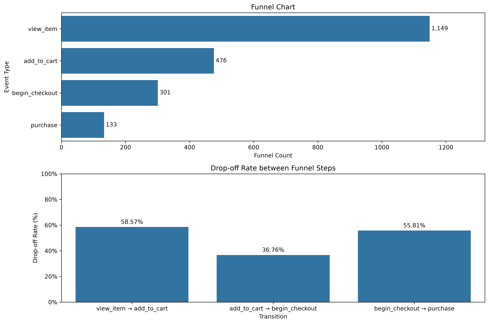
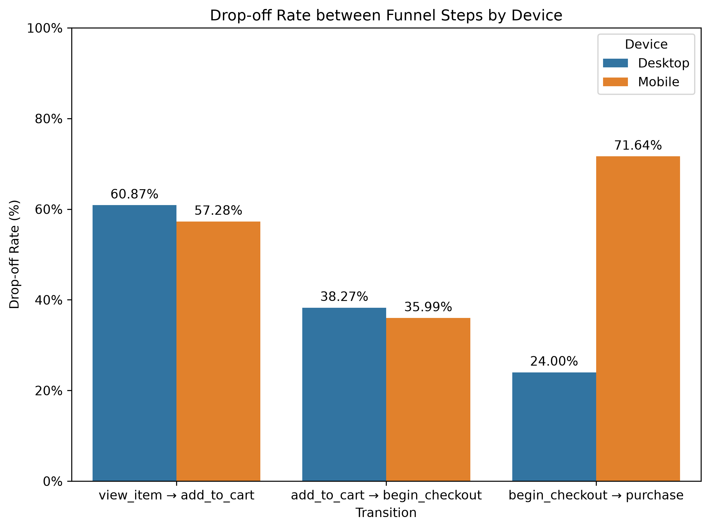

## Objective

The objective is to identify major funnel drop-off points, compare user segments, and propose improvements based on the findings.

## Data & Methodology

The `events.csv` file contains `event_id`, `user_id`, `event_type`, and `event_timestamp`.

The `users.csv` file contains `user_id`, `signup_date`, `device`, and `traffic_source`.

The funnel consists of four stages in the following order:

1. `view_item` (product viewing)
2. `add_to_cart` (adding a product to the cart)
3. `begin_checkout` (beginning checkout)
4. `purchase` (completing a purchase)

A user is counted as reaching the next stage only if the corresponding event occurs after the previous stage.

Calculation unit: Unique users are counted at each stage rather than total events.

Of the 1,200 registered users, 1,149 reached the first funnel stage (`view_item`). The remaining 51 users did not reach this stage and are therefore excluded from the funnel calculations. The denominator for overall CVR is 1,149 rather than the total number of registered users.

For segment-level overall CVR, the denominator is the number of users within each segment who reached `view_item`.

The analysis calculates overall CVR, stage-to-stage CVR, and drop-off rate.

- Overall CVR: Number of unique users at each stage ÷ Number of unique users at the first stage.
- Stage-to-stage CVR: Number of unique users at each stage ÷ Number of unique users at the previous stage.
- Drop-off rate: 1 − Stage-to-stage CVR

## Overall Funnel Analysis

| Stage | Unique Users | Overall CVR | Drop-off Rate |
|---|---:|---:|---:|
| `view_item` | 1,149 | 100.00% | — |
| `add_to_cart` | 476 | 41.43% | 58.57% |
| `begin_checkout` | 301 | 26.20% | 36.76% |
| `purchase` | 133 | 11.58% | 55.81% |

- Final Purchase Conversion Rate: 11.58%
- Maximum Drop-off: `view_item` → `add_to_cart` (673 users)
- Maximum Drop-off Rate: `view_item` → `add_to_cart` 58.57%

The largest drop-off occurs between `view_item` and `add_to_cart`, with 673 users dropping off (58.57%).
Additionally, a substantial drop-off occurs between `begin_checkout` and `purchase`, with 168 users dropping off (55.81%).

## Segment Analysis

### By Device

| Metric | Desktop | Mobile |
|---|---:|---:|
| Final purchase CVR | 18.36% | 7.76% |
| Maximum drop-off (users) | 252 | 421 |
| Maximum drop-off rate | 60.87% | 71.64% |

Desktop users have slightly higher drop-off rates than Mobile users between `view_item` and `add_to_cart`, and between `add_to_cart` and `begin_checkout`. However, Mobile users have a drop-off rate of 71.64% between `begin_checkout` and `purchase`, which is substantially higher than the 24.00% for Desktop users.

The final purchase CVR for Mobile users is 7.76%, substantially lower than the 18.36% for Desktop users.

For Desktop users, the largest drop-off occurs between `view_item` and `add_to_cart`, with 252 users dropping off (60.87%). This is also the transition with the largest drop-off in the overall funnel.

For Mobile users, the largest drop-off in user count occurs in the `view_item` → `add_to_cart` transition (421 users), whereas the highest drop-off rate occurs in the `begin_checkout` → `purchase` transition (71.64%).

This suggests that the checkout stage is a particularly important area for further investigation among Mobile users.

### By Traffic Source

| Metric | Email | Organic | Paid_Social |
|---|---:|---:|---:|
| Final purchase CVR | 14.79% | 13.89% | 6.93% |
| Maximum drop-off (users) | 80 | 308 | 285 |
| Maximum drop-off rate | 52.83% | 54.29% | 70.54% |

Paid_Social users have the highest drop-off rates among the three traffic sources in both the `view_item` → `add_to_cart` and `begin_checkout` → `purchase` transitions.

The difference is particularly pronounced in the first transition, where Paid_Social has a drop-off rate of 70.54%, compared with 47.34% for Email and 53.47% for Organic.

In contrast, Email users have the highest drop-off rate in the `add_to_cart` → `begin_checkout` transition (40.45%).

The final purchase CVR for Paid_Social users is 6.93%, lower than the 14.79% for Email users and 13.89% for Organic users.

For Email and Organic users, the largest drop-offs in user count occur between `view_item` and `add_to_cart` (80 users for Email and 308 users for Organic). However, their highest drop-off rates occur between `begin_checkout` and `purchase` (52.83% for Email and 54.29% for Organic).

For Paid_Social users, the largest drop-off in both user count and rate occurs between `view_item` and `add_to_cart`, with 285 users dropping off (70.54%). This is the same transition that has the highest drop-off rate in the overall funnel.

## Key Findings

The following findings are particularly noteworthy from the overall and segment analyses:

- The highest drop-off rate in the overall funnel occurs between `view_item` and `add_to_cart` (58.57%), followed by `begin_checkout` and `purchase` (55.81%).

- Mobile users have a substantially lower final purchase CVR (7.76%) than Desktop users (18.36%). In particular, the highest drop-off rate for Mobile users occurs between `begin_checkout` and `purchase` (71.64%).

- Paid_Social users have the lowest final purchase CVR (6.93%) among the traffic sources. Their highest drop-off rate occurs between `view_item` and `add_to_cart` (70.54%).

## Recommendations

### Mobile Checkout

Possible reasons for the high drop-off rate among Mobile users between `begin_checkout` and `purchase` include poor usability of the checkout form, unexpected shipping fees, limited payment options, concerns about payment security, and slow page loading.

I recommend conducting usability tests of the mobile checkout process, focusing on button accessibility, ease of entering required information, and the visibility of payment-related information. Based on the findings, specific improvements could then be evaluated through A/B testing.

### Paid Social Advertising

For Paid_Social users, a possible reason for the high drop-off rate between `view_item` and `add_to_cart` is a mismatch between the audience reached by advertisements and the products being promoted.

I recommend reviewing the ad targeting criteria and advertising content to assess whether they are relevant to the target audience. Revised targeting strategies or ad content could then be tested to evaluate their impact on the add-to-cart conversion rate.

## Limitations

- The available data do not provide information about the specific reasons why users drop off at each stage of the funnel.

- Although the funnel logic enforces chronological event order, the analysis does not track whether events are associated with the same product or order.

- The effectiveness of the proposed improvements has not yet been evaluated through experiments such as A/B testing.